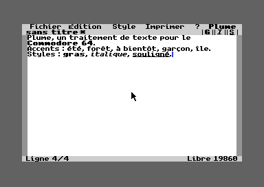
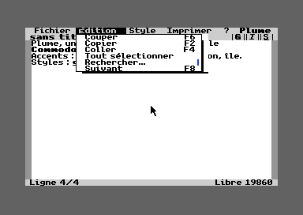
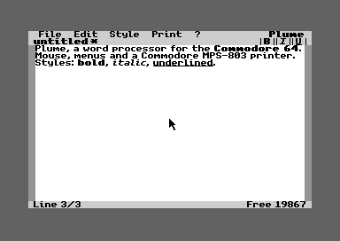
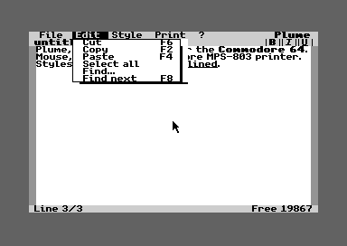

# Plume

**Un traitement de texte graphique pour Commodore 64, écrit de zéro et libre.** Souris ou joystick, menus, gras, italique, souligné, accents français, et impression sur une Commodore MPS-803, le tout sur une cartouche qui démarre directement.

*English version below.*

| Édition française | Menu Édition |
|---|---|
|  |  |

## Fonctions

- **Écran graphique** façon GEOS : police proportionnelle, texte affiché tel qu'il sera imprimé.
- **Souris 1351** sur le port 1 (une souris USB sur le C64 Ultimate) **ou joystick** sur le port 1 ou 2, menus déroulants, boîtes de dialogue.
- **Gras, italique, souligné**, à la frappe ou sur une sélection.
- **Accents français** à l'écran, dans le texte et sur papier.
- **Sélection à la souris, couper, copier, coller, rechercher.**
- **Documents jusqu'à 20 000 caractères**, enregistrés sur le lecteur 8.
- **Impression sur Commodore MPS-803 / MPS-801** (périphérique 4), marges A4 de 3 cm :
  - *Graphique* : exactement ce qui est à l'écran, accents et styles compris ;
  - *Texte* : les caractères de l'imprimante, plus rapide, sans accents ;
  - *Texte large* : double largeur.
- **Le papier s'arrête après la dernière ligne** pour pouvoir déchirer un court message.

## Utilisation

1. Copiez [`dist/plume-fr.crt`](dist/plume-fr.crt) (ou [`plume-en.crt`](dist/plume-en.crt)) sur votre carte SD ou votre cartouche flash.
2. Montez une disquette ou un `.d64` sur le lecteur 8 pour vos documents. [`dist/plume.d64`](dist/plume.d64) est un disque vierge.
3. Lancez la cartouche.

### Clavier

| Touches | Effet |
|---|---|
| `C=` + `E` / `R` / `T` | é / è / ê |
| `C=` + `A` / `Q` | à / â |
| `C=` + `C` | ç |
| `C=` + `U` / `Y` | ù / û |
| `C=` + `O` / `I` / `K` / `L` | ô / î / ï / ë |
| `C=` + `P` | œ |
| `£` | € |
| `F1` | Enregistrer |
| `F3` / `F5` / `F7` | Gras / italique / souligné |
| `F2` / `F4` / `F6` | Copier / coller / couper |
| `F8` | Rechercher le suivant |
| `RUN/STOP` | Annuler une sélection ou une boîte de dialogue |

### Joystick

Sans souris, par exemple sur un C64 d'origine avec une Kung Fu Flash, un joystick sur le port 2 (ou le port 1) déplace le pointeur. Il avance d'un pixel par image pour viser une lettre, puis accélère si l'on garde le manche poussé. Le bouton de tir sert de clic. Gardez-le enfoncé en bougeant le manche pour sélectionner du texte. Le port 2 est conseillé : le port 1 partage ses fils avec le clavier, donc Plume ignore le clavier quand le joystick du port 1 bouge.

## Matériel testé

| Configuration | État |
|---|---|
| Commodore 64 Ultimate, firmware 1.1.0, à 1 MHz et à 64 MHz | Testé : édition, fichiers, impression sur une vraie MPS-803 |
| VICE 3.10 (EasyFlash, 1541, MPS-803 émulés) | Testé, sert de banc d'essai |
| C64 d'origine avec Kung Fu Flash 2, joysticks | Testé : la cartouche démarre, le joystick pilote le pointeur (version 2.0) |

## Compiler

Outils : `make`, `python3`, [cc65](https://github.com/cc65/cc65) et [VICE](https://vice-emu.sourceforge.io) (pour `c1541`). Sur macOS :

```sh
brew install cc65 vice
make
```

Les cartouches sont dans `build/plume-fr.crt` et `build/plume-en.crt`.

## Comment c'est fait

- **Pointeur** : le pilote 1351 de cc65 pour la souris, plus une lecture directe des deux ports joystick ([`src/gfx.s`](src/gfx.s), `joy_read`).
- **Langages** : C (cc65) pour la logique, assembleur 6502 pour le dessin des caractères, la mise en page et le défilement.
- **Styles** : de petits marqueurs invisibles dans le texte, uniquement là où le style change. Un caractère coûte un octet, d'où les 20 000 caractères.
- **Mémoire** : écran graphique caché sous la ROM, mise en page et presse-papiers rangés sous les circuits d'entrée-sortie. Les 64 Ko sont utilisés au plus près.
- **Police** : [unscii](http://viznut.fi/unscii/) de viznut, dans le domaine public, rendue proportionnelle, accents redessinés.
- **Tests** : [`tools/c64plume.py`](tools/c64plume.py) pilote Plume sur un C64 Ultimate par son API réseau (frappes, clics, relecture du document, capture d'écran) grâce à une boîte aux lettres en `$02A7`.

## Licence

[MIT](LICENSE) (composants tiers : [NOTICE](NOTICE)) : vous pouvez utiliser, modifier et redistribuer Plume librement, en gardant la mention du copyright. La police unscii est dans le domaine public ; la bibliothèque d'exécution de cc65 incluse dans le programme est sous licence zlib.

---

# Plume (English)

**A graphical word processor for the Commodore 64, written from scratch and open source.** Mouse or joystick, menus, bold, italic, underline, accented characters and printing on a Commodore MPS-803, all on a cartridge that boots straight into the editor.

| English edition | Edit menu |
|---|---|
|  |  |

## Features

- **Graphical screen** in the spirit of GEOS: proportional font, what you see is what you print.
- **1351 mouse** on port 1 (a USB mouse on the C64 Ultimate) **or joystick** on port 1 or 2, pull-down menus, dialog boxes.
- **Bold, italic, underline**, while typing or on a selection.
- **Accented characters** on screen, in the text and on paper.
- **Mouse selection, cut, copy, paste, find.**
- **Documents up to 20,000 characters**, saved on drive 8.
- **Printing on a Commodore MPS-803 / MPS-801** (device 4), with 3 cm margins on A4:
  - *Graphics*: exactly what is on screen, accents and styles included;
  - *Text*: the printer's own characters, faster, without accents;
  - *Wide text*: double width.
- **The paper stops after the last line**, so short notes can be torn off.

## Usage

1. Copy [`dist/plume-en.crt`](dist/plume-en.crt) (or [`plume-fr.crt`](dist/plume-fr.crt)) to your SD card or flash cartridge.
2. Put a disk or a `.d64` in drive 8 for your documents. [`dist/plume.d64`](dist/plume.d64) is an empty one.
3. Start the cartridge.

Keys: `F1` save, `F3`/`F5`/`F7` bold/italic/underline, `F2`/`F4`/`F6` copy/paste/cut, `F8` find next, `RUN/STOP` cancels. Accented letters use `C=` plus a letter (see the table above): `C=`+`E` gives é, `C=`+`A` gives à, `C=`+`C` gives ç.

No mouse? A joystick in port 2 (or port 1) moves the pointer: one pixel per frame for precise aiming, then faster while you hold it. Fire clicks; hold fire while moving to select text. Port 2 is better: port 1 shares its wires with the keyboard, so Plume ignores the keyboard while a port 1 joystick is moving.

## Tested on

A Commodore 64 Ultimate (firmware 1.1.0) at 1 MHz and 64 MHz with a real MPS-803, and VICE 3.10. Also tested on an original C64 with a Kung Fu Flash 2 and joysticks (version 2.0).

## Building

`make`, `python3`, [cc65](https://github.com/cc65/cc65) and [VICE](https://vice-emu.sourceforge.io) are needed (`brew install cc65 vice` on macOS), then run `make`.

## License

[MIT](LICENSE). The unscii font is in the public domain; the cc65 runtime library linked into the program is under the zlib license.
